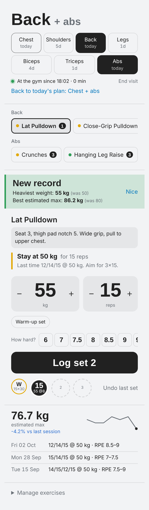
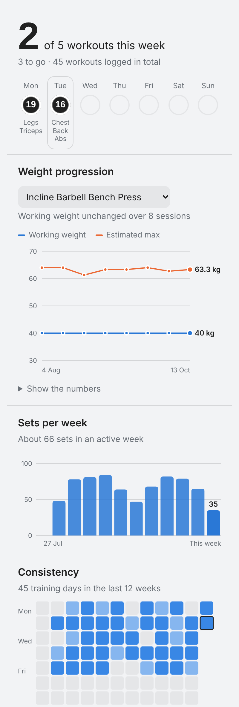
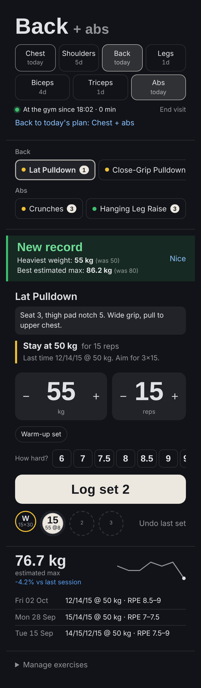

# Workout Tracker for Home Assistant

[](https://hacs.xyz/docs/faq/custom_repositories)
[](https://github.com/nilaynaik3-pixel/ha-workout-tracker/actions/workflows/validate.yml)

A gym log that lives in Home Assistant. It adds a **Workout** page to the
sidebar (and to the Home Assistant phone app) where you log sets, get
progression advice, and see how your training is going. Nothing leaves your
Home Assistant.

<p>
  
  
  
</p>

## Features

- **Rotation planner**: suggests today's main group (chest, shoulders, back,
  legs) plus an add-on (biceps, triceps, abs) based on what you trained
  longest ago.
- **Fast logging**: weight and reps with +/-, effort (RPE 6-10) per set or for
  all sets at once, warm-up sets (the first set is marked as warm-up
  automatically), undo.
- **Exercise demos**: start and end pictures of the movement shown in turn,
  plus step-by-step instructions and the muscles worked, for 870+ exercises.
- **Exercise library**: search it to add new exercises with their demo,
  muscle group and weight step filled in.
- **Rest timer** after every set, with -15/+15 s, a phone alert when the rest
  is over, and a length you choose (or off).
- **Progression advice** per exercise: go up, stay, or go down, from your last
  sessions and how hard they felt.
- **Live personal-record alerts** for heaviest weight, best estimated
  strength, and most reps on bodyweight exercises.
- **Exercise notes** (seat height, grip, machine number) and your own
  exercises, added or hidden from the page.
- **Overview**: weight progression with group and exercise filters, sets per
  week, consistency, muscle balance, personal bests, time in the gym with a
  weekly average.
- **Calendar**: tap any day to check, fix or add sets.
- **Body**: weight, body fat and measurements, height entered once, BMI with
  a trend line.
- **Gym arrival and departure** from a zone: a notification with today's plan
  when you arrive, a summary when you leave.
- **Several people**: everyone with a Home Assistant login gets their own
  tracker, with a name picker for shared tablets.
- **CSV export** of everything.
- Light and dark themes follow Home Assistant.

## Install with HACS

1. In Home Assistant open **HACS**, then the three-dot menu (top right) and
   **Custom repositories**.
2. Repository: `https://github.com/nilaynaik3-pixel/ha-workout-tracker`,
   type **Integration**, then **Add**.
3. Search HACS for **Workout Tracker**, open it, and click **Download**.
4. Restart Home Assistant.
5. **Settings > Devices & services > Add integration > Workout Tracker.**
6. Open **Workout** in the sidebar. On your phone, pull down to refresh the
   Home Assistant app first.

Updates appear in HACS like any other integration.

### Manual install

Copy `custom_components/workout_tracker` into `/config/custom_components/`,
restart, and continue from step 5.

## Setup options

| Option | What it does |
| --- | --- |
| Owner | Whose data already exists, if you used an earlier version. Usually you. |
| Training days per week | Your weekly target for the consistency chart. |
| Gym zone | Optional. Turns on automatic gym arrival and departure. |
| Person | Optional. Leave empty and each user's own person is used. |
| Notifications | `auto` sends to each person's Home Assistant phone app, `off` turns them off. |
| Ignore stays shorter than | Short passes by the gym aren't counted as visits. |

Change them later with **Configure** on the integration.

## Gym tracking

1. **Settings > Areas, labels & zones > Zones > Add zone.** Name it *Gym*,
   place the pin, radius about 100 m.
2. In the Home Assistant phone app, allow location **Always**.
3. Pick the zone under the integration's **Configure**.

Each person needs to be linked to their Home Assistant user
(**Settings > People**). Without location you can start and end visits by
hand on the Workout tab.

## Several people

Each person sees their own data when they open **Workout**. To log for
someone else, pick their name at the top of the page. Every person has
their own rotation, sets, records, body data and gym time.

## Using the cards on a dashboard

The page is built from two cards you can also put on any dashboard:

```yaml
type: custom:workout-card
```

```yaml
type: custom:workout-overview-card
```

## Your data

Stored in `/config/workout_tracker/` (one SQLite file per person) and included
in Home Assistant backups. Deleting the integration keeps the data. Use
**Export** on the Overview tab for a CSV.

## Services

Everything on the page is also a service under `workout_tracker.*`, for
example `workout_tracker.log_set`, `workout_tracker.log_body` and
`workout_tracker.export`. Add `profile: <user id>` to act for another person.
See **Developer tools > Actions** for the full list.

Events for your own automations: `workout_pr` (new record),
`workout_rest_over`, `workout_gym_arrived` and `workout_gym_left`.

## Credits

Exercise pictures and instructions come from
[free-exercise-db](https://github.com/yuhonas/free-exercise-db), released into
the public domain. `tools/build_library.py` rebuilds them.

## License

MIT
